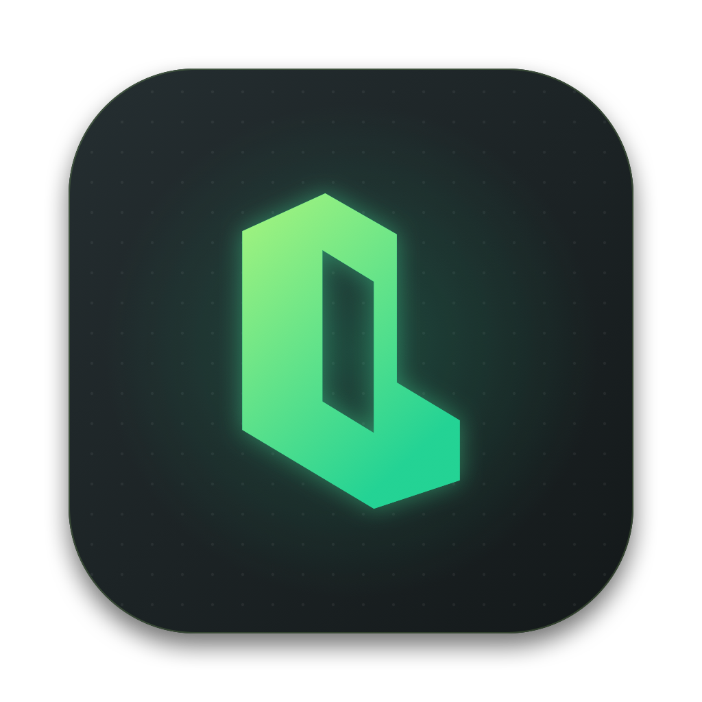
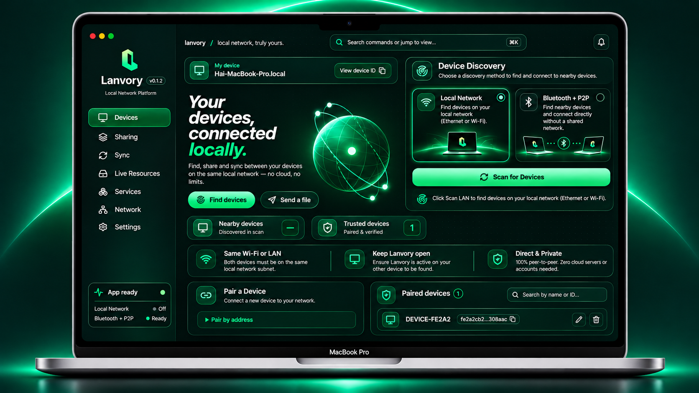
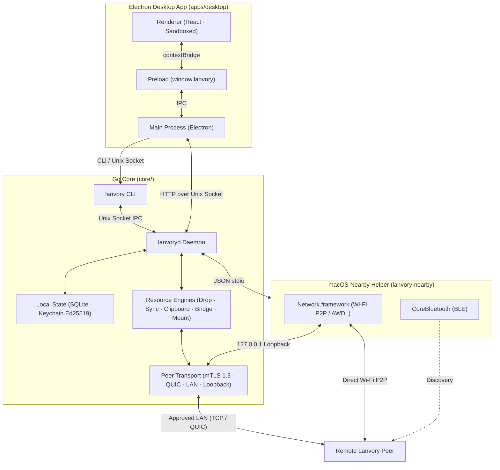

<p align="center">
  
</p>

<h1 align="center">Lanvory</h1>

<p align="center">
  <strong>Local network, truly yours.</strong><br />
  A decentralized, offline-first peer-to-peer desktop workspace for connecting devices, transferring files, syncing folders, mounting live resources, and sharing local services—with zero cloud, zero central servers, and zero accounts.
</p>

<p align="center">
  <a href="https://github.com/haitran-mindset/lanvory/releases/latest">Download for macOS</a> ·
  <a href="apps/web">Website (<code>apps/web</code>)</a> ·
  <a href="docs/architecture/overview.md">Architecture</a> ·
  <a href="docs/security/threat-model.md">Security Model</a> ·
  <a href="ROADMAP.md">Roadmap</a> ·
</p>

<p align="center">
  
</p>

---

## Overview

Lanvory runs as a local Go daemon (`lanvoryd`), CLI (`lanvory`), and Electron + React desktop app (`apps/desktop`) on each device. Every device owns its cryptographic Ed25519 identity, trust list, permissions, and data locally.

- **Offline & Peer-to-Peer**: Works over your local Wi-Fi/Ethernet network—even with Internet disconnected—or directly between nearby Macs via **Bluetooth + Wi-Fi P2P (AWDL)** without a shared router.
- **Zero Cloud, Zero Accounts**: No sign-ups, no relay servers, no telemetry, and no external control plane.
- **Default-Deny Security**: Network adapters, Bluetooth + P2P discovery, peer trust, incoming file offers, and per-resource permissions all require explicit user approval.

---

## Architecture Overview



1. **Electron Renderer & Preload (`apps/desktop/src/renderer`, `src/preload`)**: Runs in a sandboxed browser context with no direct filesystem, socket, or shell access. All privileged operations pass through the narrow `window.lanvory` preload API.
2. **Electron Main Process (`apps/desktop/src/main/index.cjs`)**: Manages the desktop window, menu bar tray, native file pickers, OS clipboard, and `lanvoryd` lifecycle, forwarding commands to `bin/lanvory` or the daemon's Unix socket.
3. **Go Daemon & CLI (`core/cmd/lanvoryd`, `core/cmd/lanvory`, `core/internal/`)**: Owns the Ed25519 identity (macOS Keychain), SQLite state (trusted peers, grants, transfer history, sync metadata), interface scope checks, and all mTLS 1.3 / QUIC peer protocols (`Drop`, `Sync`, `Clipboard`, `Bridge`, `Mount`).
4. **macOS Native Nearby Helper (`core/native/darwin/lanvory-nearby.swift`)**: Communicates with `lanvoryd` over newline-delimited JSON to run BLE advertising/scanning and open local `127.0.0.1` loopback bridges over Apple AWDL Wi-Fi P2P without a shared router.

For deeper design details, see [`docs/architecture/overview.md`](docs/architecture/overview.md) and [`docs/protocols/ipc.md`](docs/protocols/ipc.md).

---

## Download & Install (macOS)

Open the [latest stable GitHub Release](https://github.com/haitran-mindset/lanvory/releases/latest) and select the disk image for your Mac under **Assets**.

- **Apple Silicon:** choose the DMG ending in `-arm64.dmg`.
- **Intel:** choose the DMG ending in `-x64.dmg`.

### First launch on macOS (ad-hoc signed build)

Check the release notes for the build’s signing status. For an ad-hoc signed build, drag `Lanvory.app` to `Applications` and run the following command before opening the app.

```sh
xattr -cr /Applications/Lanvory.app
```

---

## Features

| Feature                                 | Description                                                                                                                                                                                             |
| --------------------------------------- | ------------------------------------------------------------------------------------------------------------------------------------------------------------------------------------------------------- |
| **Device Discovery (LAN & BLE + P2P)**  | On-demand Bonjour (`_lanvory._tcp` / `_lanvory._udp`) on approved LAN adapters, plus macOS CoreBluetooth + Wi-Fi P2P (`AWDL` via `lanvory-nearby`) without a router, and manual IPv4 endpoint fallback. |
| **Verified Pairing & Trust**            | Ed25519 device identity (`~/.lanvory/identity.key`), mutual TLS 1.3 + QUIC (with TCP fallback), and TLS-bound confirmation codes verified on both devices.                                              |
| **File Transfer (Drop)**                | Single-file offers with explicit recipient approval, streaming SHA-256 verification, atomic writes to `~/.lanvory/inbox`, cancellation, and persisted history.                                          |
| **Folder Sync**                         | Send-only, receive-only, and two-way folder synchronization with SHA-256 change detection and conflict copies.                                                                                          |
| **Live Resource Mount**                 | Share local folders with trusted peers as live WebDAV volumes (`lanvory-mount/1` over mTLS) with read-only or read-write access grants.                                                                 |
| **Service Bridge & Tunnels**            | Expose local loopback TCP services to trusted peers and access them through local loopback client tunnels with timed or revocable grants.                                                               |
| **Shared Clipboard & Network Explorer** | Clipboard sharing between trusted peers, adapter eligibility & IPv4 scope diagnostics, and authenticated peer `ping` latency checks.                                                                    |

---

## Development Setup

### Prerequisites

- **macOS** (`arm64` or `x64`) with Xcode Command Line Tools (`swiftc`, `codesign`, `hdiutil`)
- **Go 1.26+**
- **Node.js 22.12+** (CI uses Node 24) and **pnpm 12.5.1**

### Go daemon and CLI

From the repository root:

```sh
cd core
go build -o ../bin/lanvoryd ./cmd/lanvoryd
go build -o ../bin/lanvory ./cmd/lanvory
../bin/lanvoryd
```

In another shell (from the repository root):

```sh
./bin/lanvory identity
./bin/lanvory network
./bin/lanvory status --json
./bin/lanvory doctor --json
```

The daemon stores the Ed25519 seed in `~/.lanvory/identity.key` (`0600`), alongside the owner-only Unix IPC socket and local SQLite database under `~/.lanvory`. Stop the foreground daemon with `Ctrl+C`.

Run Go static checks and race-enabled tests:

```sh
cd core
go vet ./...
go test -race ./...
```

### Desktop app (`apps/desktop`)

```sh
pnpm install --frozen-lockfile
make build
make verify
pnpm desktop
```

- `make build` compiles `bin/lanvoryd`, `bin/lanvory`, `bin/lanvory-nearby` (on macOS), and the desktop renderer.
- `make verify` runs `go vet ./...`, `go test -race ./...`, `pnpm typecheck`, syntax checks (`node --check`, `sh -n`), and `pnpm build`.
- `sh scripts/smoke-identity.sh` verifies identity persistence and single-instance locking.
- `make smoke-native` exercises native window, menu bar, and daemon lifecycle behavior in isolated state directories.

> The Electron launcher downloads its pinned binary on first use if needed. Run `pnpm --filter @lanvory/desktop exec electron --version` while online to prepare a development checkout before offline testing.

### Website (`apps/web`)

The product landing page and download portal lives in [`apps/web`](apps/web):

```sh
pnpm --filter @lanvory/web dev
pnpm --filter @lanvory/web build
```

---

## CLI & Workflow Reference

### LAN adapter approval & discovery

In **Network**, choose **Turn on LAN** to approve the selected adapter and start the listener, or **Turn off LAN** to stop it and revoke approval. Via CLI:

```sh
./bin/lanvory network
./bin/lanvory network approve en0
./bin/lanvory network check en0 192.168.1.42
./bin/lanvory discover
./bin/lanvory discover resolve en0 'Lanvory INSTANCE'
./bin/lanvory network revoke en0
```

### Bluetooth + Wi-Fi P2P (AWDL) nearby discovery on macOS

On macOS, `make build` compiles `core/native/darwin/lanvory-nearby.swift` to `bin/lanvory-nearby` using CoreBluetooth and Network.framework peer-to-peer networking. Toggle **Bluetooth + P2P** in the desktop sidebar's dual status card, or use the CLI:

```sh
./bin/lanvory nearby status
./bin/lanvory nearby advertise on
./bin/lanvory nearby scan
./bin/lanvory nearby advertise off
```

See the [Bluetooth and Wi-Fi P2P protocol](docs/protocols/nearby.md) for the discovery, bridge, and pairing flow.

### Peer listener, verification, pairing & trust

Start the opt-in peer listener via the desktop **Network** view or CLI:

```sh
./bin/lanvory network listener start en0 192.168.1.20:43110
./bin/lanvory network listener stop
```

Or run the daemon directly with listener flags (`--peer-interface`, `--peer-bind`, `--peer-advertise`, `--peer-quic`, `--peer-pairing`):

```sh
./bin/lanvoryd --peer-interface en0 --peer-bind 192.168.1.20:43110 --peer-quic --peer-advertise --peer-pairing
```

Verify, ping, pair, and manage trusted peers:

```sh
./bin/lanvory identity fingerprint
./bin/lanvory peer verify en0 192.168.1.42:43110 "$peer_fingerprint"
./bin/lanvory peer verify-quic en0 192.168.1.42:43110 "$peer_fingerprint"
./bin/lanvory peer ping en0 192.168.1.42:43110 "$peer_fingerprint" --json
./bin/lanvory peer pair en0 192.168.1.42:43110 "$peer_fingerprint"
./bin/lanvory pairing list
./bin/lanvory pairing approve "$request_id" "$other_device_code"
./bin/lanvory pairing decline "$request_id"
./bin/lanvory peer trust en0 192.168.1.42:43110 "$peer_fingerprint"
./bin/lanvory peer trusted
./bin/lanvory peer revoke "$peer_fingerprint"
```

### Per-resource permissions

```sh
./bin/lanvory permissions grant "$peer_fingerprint" file-receive inbox "$expires_at"
./bin/lanvory permissions check "$peer_fingerprint" file-receive inbox
./bin/lanvory permissions list
./bin/lanvory permissions revoke "$peer_fingerprint" file-receive inbox
./bin/lanvory permissions audit
```

### File transfer (Drop)

```sh
# Receiver grants inbox permission
./bin/lanvory permissions grant "$sender_fingerprint" file-receive inbox

# Sender sends file
./bin/lanvory files send en0 192.168.1.42:43110 "$receiver_fingerprint" ./example.txt

# Receiver approves or declines
./bin/lanvory files incoming
./bin/lanvory files approve "$offer_id"
./bin/lanvory files decline "$offer_id"
./bin/lanvory files transfers
```

### Service Bridge & local tunnels

```sh
# Host machine
./bin/lanvory services share notes 127.0.0.1:8080
./bin/lanvory permissions grant "$peer_fingerprint" service-connect notes
./bin/lanvory services list
./bin/lanvory services remove notes

# Client machine
./bin/lanvory tunnels open en0 192.168.1.42:43110 "$peer_fingerprint" notes
./bin/lanvory tunnels list
./bin/lanvory tunnels stop "$tunnel_id"
```

### Live Resource Mount & Folder Sync

See [Folder Sync](docs/protocols/sync.md) for SHA-256 change detection and conflict copies, and [Live Resource Mount](docs/protocols/mount.md) for WebDAV access and permissions.

```sh
./bin/lanvory mounts
```

In Electron, open **Sync** to configure `send-only`, `receive-only`, or `two-way` folder sync, or to export, grant, and mount live peer folders (`lanvory-mount/1` WebDAV over mTLS).

---

## Packaging & CI/CD

Build a local macOS `.app` bundle or `.dmg` disk image (with SHA-256 sidecar and CycloneDX 1.6 `.cdx.json` SBOM):

```sh
make package-macos
make dmg-macos
sh scripts/smoke-macos-dmg.sh --verify-only dist/macos/*/Lanvory-*-arm64.dmg
```

- **CI Verification** ([`.github/workflows/verify.yml`](.github/workflows/verify.yml)): Runs `gofmt`, `make verify dmg-macos`, and `smoke-macos-dmg.sh --verify-only` on `macos-15` (`arm64`) and `macos-15-intel` (`x64`).
- **GitHub Releases** ([`.github/workflows/release.yml`](.github/workflows/release.yml)): Triggered on `v*` tags; builds and verifies both `arm64` and `x64` `.dmg` packages, generates `SHA256SUMS.txt` and `.cdx.json` SBOMs, and publishes the GitHub Release.

See [docs/deployment/macos.md](docs/deployment/macos.md) for Developer ID signing and Apple notarization steps.

---

## Documentation

- [PROJECT_SPEC.md](PROJECT_SPEC.md) — Master project specification and constraints
- [ROADMAP.md](ROADMAP.md) — Delivery milestones and current state
- [TASKS.md](TASKS.md) — Task-level acceptance criteria
- [HANDOFF.md](HANDOFF.md) — Engineering handoff and verification records
- [DESIGN_SYSTEM.md](DESIGN_SYSTEM.md) — Desktop design tokens and UI mapping
- [docs/architecture/overview.md](docs/architecture/overview.md) & [docs/architecture/cross-platform.md](docs/architecture/cross-platform.md)
- [docs/protocols/](docs/protocols/) — Discovery, Pairing, QUIC, Drop, Bridge, IPC, Peer Listener
- [docs/security/threat-model.md](docs/security/threat-model.md) & [docs/security/permissions.md](docs/security/permissions.md)
- [docs/development/known-limitations.md](docs/development/known-limitations.md) & [docs/development/lan-validation.md](docs/development/lan-validation.md)
