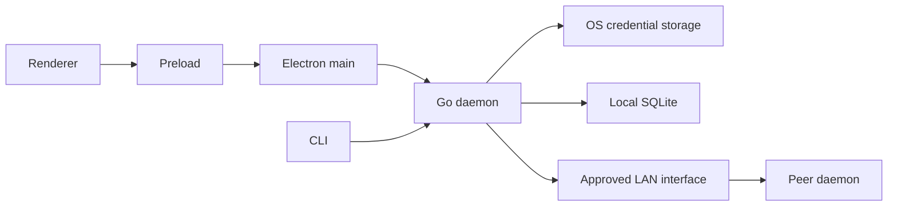

# Architecture

Every device owns its identity, local settings and permissions. Electron main is the only desktop process permitted to call the daemon. The renderer receives a narrow, versioned API from preload. The CLI is a second local client.

The macOS daemon provides owner-authenticated IPC over a private Unix socket. Its Keychain entry holds the Ed25519 seed, while SQLite holds profile metadata, adapter approvals, trusted peers, grants, and transfer history. DNS-SD advertises availability using a random label. Resolving a record checks the approved interface and subnet without granting trust.

Opt-in peer listeners bind to the approved interface. Pairing uses a dedicated TCP TLS 1.3 protocol, pins the receiver key, and requires approval on both devices. Drop and Bridge use mutually authenticated QUIC by preference, with pinned TCP fallback after a UDP handshake timeout. The daemon checks resource grants separately from identity and rechecks them during active operations. Bridge uses locally registered loopback destinations. Drop asks for consent on each incoming offer.

See [IPC](../protocols/ipc.md), [pairing](../protocols/pairing.md), [QUIC](../protocols/quic.md), and the [threat model](../security/threat-model.md) for the respective boundaries.

## Reference decisions

- [RFC 6762](https://datatracker.ietf.org/doc/rfc6762/) and [RFC 6763](https://datatracker.ietf.org/doc/html/rfc6763) define multicast discovery and service records. Treat records as untrusted and minimize metadata.
- [LocalSend](https://github.com/localsend/protocol/blob/main/README.md) demonstrates direct offline transfer. Lanvory will use its own wire format and approval model.
- [Electron safeStorage](https://www.electronjs.org/docs/latest/api/safe-storage) documents platform differences. The daemon must own the key to support standalone operation. A missing secure store requires a visible failure or a separately designed fallback.

## Distributed dependency notices

Compared the macOS arm64 bundle in `dist/macos/0.1.0-arm64-smHPyR` against its installed dependencies and linked Go modules.

- React and React DOM 19.3.1 and Zod 4.6.7 declare MIT. Lucide React 0.468.0 declares ISC. The package also includes the Scheduler dependency notice.
- Electron 45.4.1 ships its own license and Chromium attribution HTML. Both match the installed Electron distribution.
- Go's runtime license and the license of every module identified by `go version -m` match the local sources. The linked modules are quic-go 0.65.0 (MIT), golang.org/x/crypto 0.54.0, golang.org/x/net 0.56.0, and golang.org/x/sys 0.47.0. The package includes the corresponding Go module patent notices where supplied.
- `otool -L` shows SQLite, Security and CoreFoundation are linked from macOS system paths. The package uses the system libraries.

This inventory covers the audited ad hoc macOS arm64 build. Re-run the checks when changing packaged dependencies and during release review. See [cross-platform architecture](cross-platform.md) for the credential-store, IPC, interface-binding, and packaging specifications for Linux and Windows platforms.
