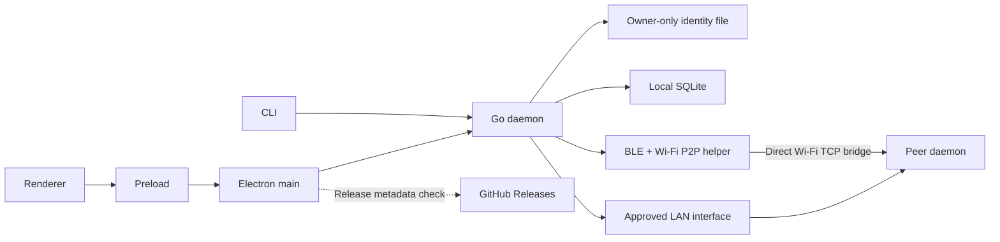

# Architecture

Every device owns its identity, local settings and permissions. Electron main is the only desktop process permitted to call the daemon. The renderer receives a narrow, versioned API from preload. The CLI is a second local client.

The macOS daemon provides owner-authenticated IPC over a private Unix socket. Its Ed25519 identity seed is persisted locally under `~/.lanvory/identity.key` (`0600`) inside an owner-only (`0700`) directory, while SQLite holds profile metadata, adapter approvals, trusted peers, grants, sync state, and transfer history. DNS-SD advertises availability using a random label. Resolving a record checks the approved interface and subnet without granting trust.

## Peer paths and resource protocols

LAN discovery uses DNS-SD on approved interfaces. The macOS Nearby helper uses BLE to discover nearby devices and Network.framework's peer-to-peer Wi-Fi transport to bridge TCP between the two daemons. In both paths, names and discovery metadata are candidate hints until pairing verifies the peer.

| Capability | Protocol and boundary |
| --- | --- |
| Discovery | [LAN DNS-SD](../protocols/discovery.md) and [Bluetooth + Wi-Fi P2P](../protocols/nearby.md) provide distinct discovery paths. |
| Pairing | [Confirmed pairing](../protocols/pairing.md) uses TLS 1.3, an Ed25519 peer identity, and a session-derived confirmation code. Both devices approve. |
| Drop and Bridge | [Drop](../protocols/drop.md) verifies each approved file with SHA-256. [Bridge](../protocols/bridge.md) forwards only to locally registered loopback services. Over LAN, both prefer [QUIC](../protocols/quic.md) and fall back to pinned TCP after a handshake timeout. |
| Folder Sync | [Folder Sync](../protocols/sync.md) runs over scoped TCP with mutual TLS. It compares SHA-256 hashes and attempts to keep conflict copies during bidirectional writes. |
| Live Resource Mount | [Live Resource Mount](../protocols/mount.md) exposes individually granted WebDAV exports through a local loopback proxy using mutually authenticated TCP or QUIC. |
| Release notices | The Electron main process checks GitHub for a newer stable release. The user's download action opens the matching DMG in the browser for manual installation. See [macOS packaging](../deployment/macos.md). |

See [local IPC](../protocols/ipc.md), [peer permissions](../security/permissions.md), and the [threat model](../security/threat-model.md) for the trust boundaries.

## Reference decisions

- [RFC 6762](https://datatracker.ietf.org/doc/rfc6762/) and [RFC 6763](https://datatracker.ietf.org/doc/html/rfc6763) define multicast discovery and service records. Treat records as untrusted and minimize metadata.
- [LocalSend](https://github.com/localsend/protocol/blob/main/README.md) demonstrates direct offline transfer. Lanvory will use its own wire format and approval model.
- [Electron safeStorage](https://www.electronjs.org/docs/latest/api/safe-storage) documents platform differences. Lanvory currently keeps identity ownership in the daemon and uses the owner-only state directory for key storage.

## Distributed dependency notices

Compared the macOS arm64 bundle in `dist/macos/0.1.0-arm64-smHPyR` against its installed dependencies and linked Go modules.

- React and React DOM 19.3.1 and Zod 4.6.7 declare MIT. Lucide React 0.468.0 declares ISC. The package also includes the Scheduler dependency notice.
- Electron 45.4.1 ships its own license and Chromium attribution HTML. Both match the installed Electron distribution.
- Go's runtime license and the license of every module identified by `go version -m` match the local sources. The linked modules are quic-go 0.65.0 (MIT), golang.org/x/crypto 0.54.0, golang.org/x/net 0.56.0, and golang.org/x/sys 0.47.0. The package includes the corresponding Go module patent notices where supplied.
- `otool -L` shows SQLite, Security and CoreFoundation are linked from macOS system paths. The package uses the system libraries.

This inventory covers the audited ad hoc macOS arm64 build. Re-run the checks when changing packaged dependencies and during release review. See [cross-platform architecture](cross-platform.md) for the credential-store, IPC, interface-binding, and packaging specifications for Linux and Windows platforms.
